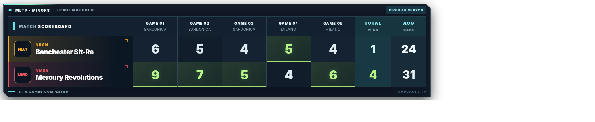
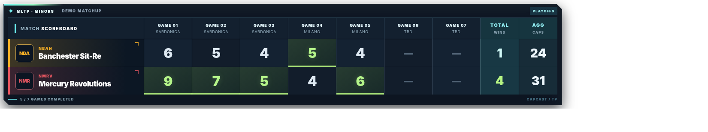
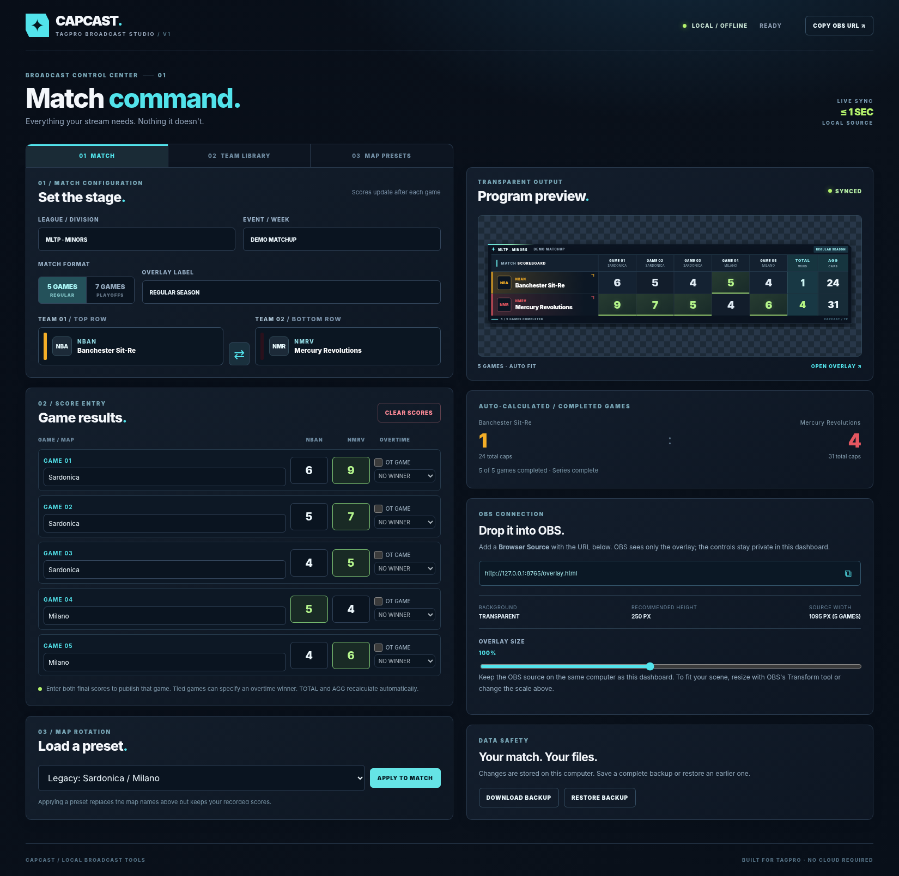
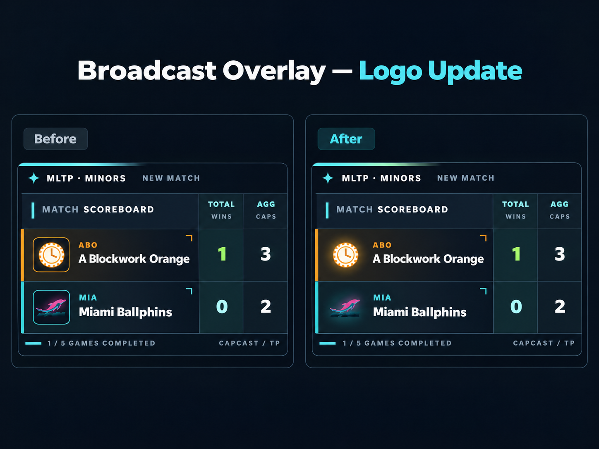
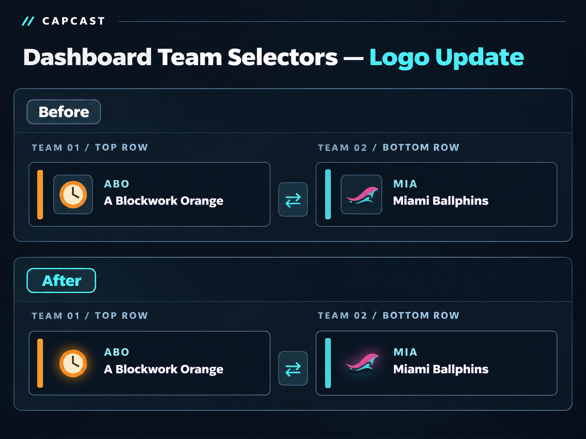

# CAPCAST

### A modern, customizable TagPro scoreboard overlay for OBS Studio.

**CAPCAST** is a free, locally hosted scoreboard system designed for competitive TagPro broadcasts. It combines a transparent, broadcast-ready OBS overlay with a dedicated control dashboard, allowing commentators and streamers to manage matches without touching their OBS configuration.

No subscriptions. No accounts. No cloud services. Just a scoreboard that works.

**[Download the latest CAPCAST release](https://github.com/erikasdratini/capcast-tagpro-scoreboard/releases/tag/v1.1.1)** · [Installation](#installation) · [Features](#features) · [Privacy & security](#privacy-and-security)

## Screenshots

### Five-game regular-season scoreboard



### Seven-game playoff scoreboard



### Live control dashboard



### Logo Design Update — v1.1.1

Version 1.1.1 introduces floating team logos with subtle, team-colored glows, replacing the previous boxed appearance.

*Illustrative comparisons of the logo treatment:*

**Broadcast overlay**



**Dashboard team selectors**



---


**Version:** 1.1.1 — Community Beta ([changelog](CHANGELOG.md))  

**Platforms:** Windows, macOS, Linux  

**Requirements:** Python 3.11 or newer recommended (3.9 and 3.10 also run, with a compatibility warning) and OBS Studio (31 or newer recommended)

**Cost:** Free

---

## Features

### Broadcast-ready scoreboard
- Modern, dark-themed scoreboard with team-color accents.
- Transparent background for seamless OBS integration.
- Five-game regular-season and seven-game playoff layouts.
- Automatically expanding scoreboard for longer series.
- Customizable team names, abbreviations, colors, and logos.
- Map names displayed for each game.
- Highlighted winning scores.
- Automatic series-win and aggregate-cap calculations.
- Flexible positioning and scaling within OBS.

### Dedicated control dashboard
- Manage everything from a separate browser window.
- Select teams from a searchable database.
- Enter final scores after each game.
- Automatically calculate game wins and aggregate caps.
- Track overtime results and designate overtime winners.
- Swap teams without losing their results.
- Clear scores between matches.
- Preview the broadcast scoreboard before and during a stream.
- Update the OBS overlay automatically when changes are made.
- See at a glance whether OBS is showing the latest scores (`OBS IN SYNC · REV n`), with a clear warning when it is not.
- Keep two open dashboards from overwriting each other.

### Customizable team library
- 30 starter team records, including historical competitive TagPro teams.
- Add, edit, and remove teams.
- Customize team abbreviations and colors.
- Upload PNG, JPG, or WebP team logos (resized to 256 px on your computer).
- Search teams by name, abbreviation, or division.
- Import and export team databases using JSON or CSV.

**Note:** Historical team colors are approximate, and logos are placeholders until verified source data is incorporated. All teams can be customized.

### Map rotation management
- Create and save custom map rotation presets.
- Apply a complete rotation to a match.
- Override individual map selections at any time.
- Support up to seven map slots per preset.
- Reuse saved rotations across broadcasts.

### Local data and backups
- Automatically save match and team configuration data.
- Automatic safety copies in `data/backups/` before risky actions.
- Restore previously saved configurations, including v1.1 backups, with a preview of what will change.
- Export backups for safekeeping.
- Retain settings between sessions.
- Operate without external servers or accounts.

---

## Download

**[Download CAPCAST v1.1.1 from GitHub Releases](https://github.com/erikasdratini/capcast-tagpro-scoreboard/releases/tag/v1.1.1)**

**For normal installation, download this exact file:**

`CAPCAST_TagPro_OBS_Scoreboard_Community_v1.1.1.zip`

Extract it to a new folder on your computer.

The separate source-code archives are intended for developers. You do not need them, Git, or a GitHub account to run CAPCAST.

You can verify your download using the SHA-256 checksum supplied in the release notes.

---

## Installation

### Windows

**Step 1 — Install Python**

CAPCAST recommends Python 3.11 or newer (3.12+ preferred). Python 3.9 and 3.10 can still run CAPCAST but display a compatibility warning because those versions no longer receive security updates.

If you don't already have it installed, download it from:

https://www.python.org/downloads/

During installation, enable **Add Python to PATH** if that option is available.

No additional Python packages are required.

**Step 2 — Download CAPCAST**

1. Open the Releases section of this repository.
2. Download `CAPCAST_TagPro_OBS_Scoreboard_Community_v1.1.1.zip` (not the source-code ZIP).
3. Right-click the ZIP and select **Extract All**.
4. Open the extracted `CAPCAST_TagPro_Scoreboard` folder.

**Step 3 — Launch CAPCAST**

Double-click:

`start-windows.bat`

A terminal window will open, starting the local scoreboard server.

Your default browser should automatically open the CAPCAST control dashboard.

If it doesn't, navigate to:

`http://127.0.0.1:8765/`

**Keep the terminal window open while broadcasting.** Closing it stops the local scoreboard server.

### macOS

1. Install Python 3.11 or newer from [python.org](https://www.python.org/downloads/) if necessary (Python 3.12+ preferred).
2. Download `CAPCAST_TagPro_OBS_Scoreboard_Community_v1.1.1.zip` from the [v1.1.1 release](https://github.com/erikasdratini/capcast-tagpro-scoreboard/releases/tag/v1.1.1).
3. Extract the ZIP and open the `CAPCAST_TagPro_Scoreboard` folder.
4. Open Terminal in that folder and run:

```bash
python3 server.py
```

5. Open `http://127.0.0.1:8765/` in your browser if it does not open automatically.

Keep Terminal open while using CAPCAST.

**Optional launcher:** You can also double-click `start-mac.command`. On macOS 15 or later, if macOS blocks the launcher, first confirm that you downloaded it from the official CAPCAST release. After attempting to open it, go to **System Settings → Privacy & Security**, scroll to the security warning, and select **Open Anyway**, if available. Follow the confirmation prompts.

For the simplest installation, use the Terminal command above instead of the optional launcher.

**Note:** macOS compatibility has not yet been verified through a complete manual installation test.

### Linux

1. Ensure Python 3 is installed.
2. Download and extract CAPCAST.
3. Open a terminal in the extracted folder.
4. Run:

```bash
python3 server.py
```

An optional `start-linux.sh` launcher is also included.

---

## Connecting CAPCAST to OBS

Once CAPCAST is running:

1. Open OBS Studio.
2. Select the scene where you want your scoreboard.
3. Under **Sources**, click the **+** button.
4. Select **Browser**.
5. Create a new source named `CAPCAST Scoreboard`.
6. Leave **Local file** unchecked.
7. Enter the following URL:

```text
http://127.0.0.1:8765/overlay.html
```

8. Set the Browser Source dimensions:

| Setting | Recommended value |
|---|---|
| Width / Height | As shown under **SOURCE WIDTH / SOURCE HEIGHT** in the dashboard's OBS panel (about 1100 × 260 for 5 games, 1320 × 260 for 7 games, at 100%) |
| Local file | Unchecked |
| Page permissions | No access to OBS |
| Custom CSS | Default is fine |

9. Click **OK**.
10. Position and resize the scoreboard using OBS's transform handles.

The overlay background is transparent, allowing the scoreboard to appear directly over gameplay.

**Important:** CAPCAST and OBS should run on the same computer. The scoreboard server uses your computer's local loopback connection.

---

## Using CAPCAST

### 1. Configure a match

Open the control dashboard:

`http://127.0.0.1:8765/`

Choose your teams, enter the event information, and select a match format:

- **5 Games:** Regular-season layout.
- **7 Games:** Playoff layout.

These formats are configurable presentation options and may not reflect the rules of every TagPro league or season.

### 2. Choose the maps

Select a saved map rotation preset or enter the map names manually.

Presets can be created and edited from the **Map Presets** tab.

### 3. Enter scores

After each game, enter both teams' final scores into the dashboard.

The game result appears on the OBS overlay when both scores are entered.

CAPCAST automatically updates:

**TOTAL:** Number of games won by each team.

**AGG:** Aggregate caps scored across completed games.

Winning scores are visually highlighted.

For tied regulation scores, tick **OT GAME** and choose the overtime winner. Until you do, the tied game is shown as pending and is not counted. The overtime winner wins the game and gets one extra cap on stream and in the aggregate: a 2–2 game won in overtime by the top team shows 3–2. The score boxes keep the 2–2 you entered, and the extra cap is removed if you untick **OT GAME** or clear the winner. If the entered scores are not tied, no cap is added.

Score boxes accept whole numbers from 0 to 999. Anything else turns red and is **not published** until it is fixed. The mouse wheel never changes a score.

### Sync status

The top right of the dashboard always shows two things:

- **SAVED · REV n**: your changes are saved. If saving is blocked, a red banner explains why and what to do.
- **OBS IN SYNC · REV n**: the OBS browser source is showing exactly that saved version. If OBS falls behind, shows an error, or is not connected, the dashboard says so instead. It never claims OBS is in sync while changes are still waiting to be saved.

The dashboard checks the status once a second. Your own edits switch it to **WAITING FOR SAVE** straight away. A change made somewhere else, such as another window, a restart of CAPCAST, or an edited `state.json`, can take up to about 2 seconds to show.

If CAPCAST is restarted with different saved data while the dashboard has unsaved edits, the dashboard shows **CAPCAST WAS RESTARTED** and does not overwrite anything until you choose.

### 4. Start the next match

Select the next two teams, update your maps, and use **Clear Scores** to reset the previous results.

The OBS Browser Source does not need to be recreated.

---

## Team Database

CAPCAST includes 30 starter team records spanning multiple eras of competitive TagPro.

The team library supports:

- Custom team names.
- Team abbreviations.
- Primary and secondary colors.
- Custom logos.
- League or season information.
- JSON and CSV imports and exports.

Additional teams can be added at any time.

The starter database is not intended to be a definitive historical archive. Team names, colors, and logos may require verification.

---

## How CAPCAST Works

CAPCAST consists of two primary interfaces:

**Control Dashboard**

`http://127.0.0.1:8765/`

This is where you manage teams, maps, scores, settings, and backups.

**OBS Overlay**

`http://127.0.0.1:8765/overlay.html`

This displays only the broadcast scoreboard, without the control interface.

Both are served by a lightweight Python server running locally on your computer.

Changes made in the control dashboard are automatically reflected in the OBS overlay, without manually refreshing the Browser Source.

No third-party Python packages are required.

---

## Privacy and Security

CAPCAST runs entirely on your computer. It makes no internet requests, uses no analytics or accounts, and needs no third-party Python packages.

- The server listens only on `127.0.0.1`. Other devices on your network or the internet cannot connect unless you forward the port. **Do not expose or port-forward port 8765.**
- Web pages open in your browser *can* send requests to `127.0.0.1`. CAPCAST refuses requests whose `Host` or `Origin` is not `http://127.0.0.1:8765`, and requests that browsers mark as coming from another site. It also tells browsers not to let other sites load or frame its files.
- Every save is checked against a strict format, including the type and dimensions of logos. New logos are resized to 256 px in your browser.
- Each saved version gets a revision number. A dashboard working from an older revision cannot overwrite a newer one, and the dashboard shows whether OBS is displaying the latest saved version.
- Data is written atomically. Automatic copies are kept in `data/backups/`, and any file CAPCAST refuses to load is kept in `data/quarantine/`.
- There is no login. Other software running on your computer under your account can read or change CAPCAST's data.
- Only import team libraries, backups and logos from sources you trust.
- In OBS, set the Browser Source's **Page permissions** to **No access to OBS**.

**Review status:** CAPCAST v1.1.1 received an AI-assisted code review, a separate adversarial re-test, and automated testing on Linux using Python 3.9–3.14 and Chromium. The maintainer also successfully performed a limited manual rehearsal on Windows using OBS Studio 33.0.1, verifying Browser Source rendering, synchronization, score calculations, overtime, five/seven-game layouts, and team logos. macOS compatibility and extended live-broadcast reliability remain unverified. This review does not constitute a formal security audit, penetration test, or certification. Please report security issues privately; see [SECURITY.md](SECURITY.md).

---

## Backups and Updates

CAPCAST saves its local application state in:

`data/state.json`

This includes team configurations, map presets, and match data.

To upgrade (for example from v1.1):

1. In the old version, click **DOWNLOAD BACKUP**.
2. Extract the new release to a **new** folder and start it.
3. Click **RESTORE BACKUP** and choose the file from step 1. CAPCAST shows what will change and asks before replacing anything.

You can also copy your old `data/state.json` into the new folder's `data/` folder before the first start. CAPCAST upgrades it automatically, keeps an exact copy of the original in `data/backups/`, and lists any adjustments under **SERVER NOTICES**.

The release ZIP no longer contains `data/state.json`. Extracting a new version over an old folder therefore cannot overwrite your data.

---

## Current Limitations

CAPCAST is an early community release.

Currently:

- Scores are entered manually after each game.
- Live in-game scoring is not supported.
- Automatic TagPro match-data integration is not included.
- The control dashboard and OBS overlay must run on the same computer.
- Direct Excel (`.xlsx`) importing is not supported.
- Historical team colors and logos are not yet fully verified.
- **Security review and platform testing:** CAPCAST v1.1.1 has undergone AI-assisted code review, adversarial retesting, and automated testing on Linux. A limited manual Windows/OBS Studio 33.0.1 rehearsal also passed. However, the application has not undergone a formal independent security audit, macOS testing is outstanding, and extended live-broadcast reliability has not yet been verified.
- If OBS gives custom browser docks the same `window.obsstudio` object as browser sources, an overlay opened as a dock counts as an OBS source in the sync status.
- OBS 30 and older use an older browser engine, so parts of the overlay styling may look different there.

These limitations may be addressed in future versions.

---

## Feedback, Bugs, and Feature Requests

CAPCAST is an ongoing community project.

If you encounter a bug, have an idea for a feature, or want to suggest an improvement, please use the **Issues** tab on this repository.

Feedback from TagPro players, commentators, and tournament organizers is welcome.

Potential future improvements include expanded historical team data, additional overlay themes, more customization options, and improved broadcast automation.

---

## Contributing

Contributions and suggestions are welcome.

If you're interested in improving CAPCAST, feel free to review the source code, open an issue, or submit a pull request.

Please avoid including personal match backups, private account information, or copyrighted team graphics without permission.

CAPCAST is released under the [MIT License](LICENSE).

### Running the tests

```bash
python3 -B -m unittest discover -s tests -p 'test_server.py'   # server, standard library only
python3 -B -m unittest tests.test_parity tests.test_scoring    # needs Node.js
pip install playwright && python -m playwright install chromium
python3 -B -m unittest tests.e2e.test_e2e                       # browser tests
python3 -B -m unittest tests.test_dist                          # builds and checks the release ZIP (Linux/macOS)
python3 tools/build_release.py                                  # builds dist/ ZIP + SHA256SUMS.txt
```

---

## Acknowledgments

Built for the competitive **TagPro** community and the commentators who help keep its matches entertaining.

CAPCAST is an independent community project and is not officially affiliated with TagPro, Major League TagPro, or OBS Studio.

---

**CAPCAST — Built for TagPro. Made for the broadcast.**
